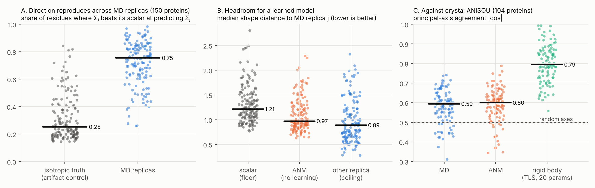

# Stage 1 audit: is per-residue anisotropy worth a covariance?

Run 2026-11-10. Reproduce with:

```
python experiments/audit/00_build_dataset.py --n 150                      # random draw, seed 0
python experiments/audit/00_build_dataset.py --entries $(cat data/highres_entries.txt) --out data/audit_highres
python experiments/audit/02_audit.py
python experiments/audit/03_figures.py
python experiments/audit/04_physical_units.py
```

**Data.** 150 ATLAS entries drawn at random (seed 0) from the 1,138 of
60–300 residues: 23,480 residues, 3 x 100 ns replicas each at 1,000 frames.
For the crystal comparison, a second seeded draw of 60 entries at <= 1.2 Å
resolution is added, selected on resolution only. 99 proteins in total have
usable Cα ANISOU records. Nothing was selected on flexibility or outcome.

**Statistics.** Each number is a per-protein mean with a 95% bootstrap CI
over proteins, since residues within a protein are not independent.
Full output: `results/02_audit/report.md` (regenerated, not committed).



## Verdict

| Question | Answer |
|---|---|
| Is the anisotropy real? (kill criterion) | **Yes.** Reproducible across independent MD replicas, well above a superposition-artifact control, in 132/150 proteins. |
| Is the scalar a bad guess? | **No, but it is beaten.** A calibrated ellipsoid region is ~17% smaller than the sphere for the median residue, and >= 2x smaller for 10% of residues. |
| Is raw anisotropy safe to use? | **No.** Taken at face value it is overconfident and its held-out likelihood is no better than the scalar's. Shrunk toward isotropy (alpha ~ 0.74), it wins clearly. |
| Is it predictable without learning? | **Partly.** A one-parameter elastic network (ANM) closes ~47% of the gap from scalar to the replica ceiling. Neither DynaProt nor BackFlip-2 reports this baseline. |
| Does MD direction match experiment? | **Not shown.** Against crystal ANISOU, MD and ANM principal axes are barely above random; crystal anisotropy is dominated by whole-molecule rigid-body motion (TLS). |

## R1 — Reproducibility (the kill criterion)

| | value |
|---|---|
| Σᵢ beats iso(Σᵢ) at predicting Σⱼ | 72% [69, 75] |
| same, isotropic truth through the same superposition (artifact control) | 32% [30, 35] |
| margin over control | 40 pts [36, 43] |
| proteins clearing their own control by > 10 pts | 132 / 150 |
| robustness: fit on starting structure / fit on rigid half only | 72% / 79% |

The control matters: superposition bias is a deterministic, directional
function of the structure, reproduces across replicas, and reaches up to
~80% on its own for a few proteins. Chance for this test is not 50%. Fitting
on the rigid half of the protein reduces the artifact and *raises* the win
rate, so the artifact is not producing the signal.

**Kill criterion not triggered.**

## R2 — How much of it is real, and what it is worth

| | value |
|---|---|
| fractional anisotropy (median per protein) | 0.65 [0.63, 0.66] |
| optimal shape power α, replica → replica | 0.74 [0.71, 0.76] |
| principal-axis \|cos\|, replica → replica (random 0.5) | 0.77 [0.76, 0.79] |
| held-out log-likelihood gain over scalar, raw Σ (nats/res/frame) | −0.055 [−0.136, 0.018] |
| same, Σ shrunk to α | +0.167 [0.144, 0.192] |

**Held-out check (Phase 0.3, `06_heldout_alpha.py`).** With α fitted on
the 83 train proteins (homology split) by held-out likelihood, α = 0.55. On
the 34 test proteins: raw Σ −0.118 [−0.326, 0.048], shrunk +0.155
[0.092, 0.220] nats/res/frame. The conclusion survives held-out fitting. (The
0.74 above minimises shape distance, a different criterion, so the two
values are not interchangeable. The fusion benchmark used 0.74; per-residue
priors there differ from scalar by ~0.03 Å either way.)

α < 1 means one replica's ellipsoid is *more* elongated than what the other
replica supports; a quarter of its log-anisotropy is sampling noise. Used raw,
that overconfidence costs as much likelihood as the direction gains. Shrunk,
it is a clear win. (α is fitted on the same replica pairs it is scored on;
one parameter per protein over ~10^5 residue-frames, so leakage is small, but
a held-out-protein α is the clean version.)

In physical units (`04_physical_units.py`):

| | median |
|---|---|
| RMS motion along long / mid / short axis | 0.97 / 0.62 / 0.38 Å |
| long / short ratio (IQR) | 2.3 (1.8–3.1) |
| scalar RMS | 0.71 Å: understates long axis by 26%, overstates short axis 1.7x |
| principal-axis error: random / ANM / other replica | 60° / 38° / 26° |
| coverage of a nominal 95% region on the held-out replica | ellipsoid 91.8%, sphere 93.5% |
| volume of a region that truly covers 95% | ellipsoid 19.3 ų, sphere 24.6 ų |
| residues where the ellipsoid is smaller / >= 1.5x / >= 2x | 71% / 25% / 10% |

## R3 — Predictable from structure alone?

ANM: Cα springs within 15 Å of the starting structure, one global constant,
no training data.

| | value |
|---|---|
| ANM direction beats scalar vs MD | 66% [62, 69] |
| ANM optimal shape power | 0.95 [0.88, 1.01] |
| shape distance to replica j: scalar / ANM tuned / other replica | 1.32 / 1.10 / 0.98 |
| fraction of scalar→ceiling gap closed by ANM (median) | 0.47 [0.40, 0.56] |

This is the bar for any learned covariance model. A learned model's value
over physics is at most the remaining ~half of the gap.

## R4 — Against experiment (crystallographic ANISOU, 99 proteins)

| | value |
|---|---|
| fractional anisotropy, crystal vs MD | 0.32 vs 0.65 |
| MD / ANM beats scalar vs crystal | 7% / 20% |
| MD / ANM optimal shape power vs crystal | 0.11 / 0.20 |
| MD / ANM principal-axis \|cos\| (random 0.5) | 0.58 / 0.58 |
| one rigid body (TLS, 20 params, in-sample) beats scalar | 67%, \|cos\| 0.80 |
| TLS + MD shape fits better than TLS + same-size scalar | 23 / 99 proteins |
| TLS + ANM shape fits better than TLS + same-size scalar | 28 / 99 proteins |

Crystal Cα anisotropy is half as large as MD's, and mostly whole-molecule
rigid-body motion. After removing it, MD internal-motion direction does not
help. Two readings, not yet separable:

1. MD per-residue direction is not physically right; or
2. crystal ANISOU cannot see it: lattice packing suppresses internal motion,
   rigid-body/lattice disorder dominates, and ANISOU refinement is
   restrained (rigid-bond and similarity restraints shape U).

Either way, **no published covariance model has been validated against
experimental anisotropy**, and the training target (MD) does not agree with
the one large experimental source available.

## R5 — Where the signal lives

| stratum | n | replica win | control | log-lik (raw) | ANM win |
|---|---:|---:|---:|---:|---:|
| helix | 9,927 | 73% | 30% | +0.011 | 68% |
| strand | 4,452 | 73% | 33% | +0.055 | 66% |
| coil | 9,101 | 73% | 28% | −0.084 | 67% |
| termini (5 res) | 1,500 | 62% | 28% | −0.476 | 52% |
| RMSF low third | 7,827 | 76% | 32% | +0.095 | 67% |
| RMSF mid third | 7,826 | 78% | 33% | +0.189 | 77% |
| RMSF high third | 7,827 | 65% | 24% | −0.336 | 57% |

Direction is equally reproducible across secondary-structure types. It pays
in the rigid and intermediate residues and costs in the most flexible
residues and termini, where between-replica differences are largest. A
model that is anisotropic everywhere is wrong in the floppy third.

## Caveats

- MD replicas share a starting structure; R1 is reproducibility within MD,
  not correctness.
- 60–300 residues only. Larger proteins have smaller superposition bias and
  may differ.
- 1,000-frame archives (100 ps spacing). Full-resolution trajectories would
  tighten per-replica estimates but not change R1, which does not use n_eff.
- TLS in R4 is fitted in-sample (20 params vs ~6 x n_res observations).

## What this means for the project

- The audit has a clear, publishable shape: anisotropy is real in MD, it is
  worth something only after shrinkage, a free physics baseline gets about
  half of it, and nothing connects it to experiment. None of these are
  reported for DynaProt or BackFlip-2.
- Stage 2 has a concrete motivation: what experiment *does* see is rigid-body
  rotation + translation, which a per-residue 3x3 positional covariance
  cannot express and an se(3) representation can.

## Next

1. **Q2/Q3 on the published models.** Obtain DynaProt / BackFlip-2 predicted
   covariances on the ATLAS test split. Place them on the R3 ladder (do they
   beat ANM?) and run calibration (coverage, χ²₃ with `scale_factor`).
2. **Experimental direction without the crystal confound.** Conformational
   variability across many PDB structures of the same protein (different
   crystal forms, ligands, labs).
3. Held-out-protein α, and residue-level models of *when* to trust
   anisotropy (rigid vs flexible).

## Rerun note (2026-11-10, 20:46 UTC)

Results regenerated and now committed (`results/02_audit/`,
`results/04_physical_units.json`, `results/06_heldout_alpha.json`; entry lists
in `manifests/`). The random-150 numbers reproduce exactly (72% [69, 75] vs
32% [30, 35]; 132/150; median ellipsoid region 17% smaller; axis error
26° / 38° / 60°; held-out α gain +0.155 [0.092, 0.220]). The high-resolution
crystal draw had to be reconstructed (`experiments/audit/00b_highres_entries.py`;
the original list was lost) and gives **104** proteins with usable ANISOU
instead of 99. R4 conclusions are unchanged: TLS + MD shape beats TLS + scalar
in 24/104 (was 23/99), TLS + ANM shape in 31/104 (was 28/99); MD beats scalar
against crystal in 7% of residues, ANM in 20%. The R4 table above keeps the
original numbers.
