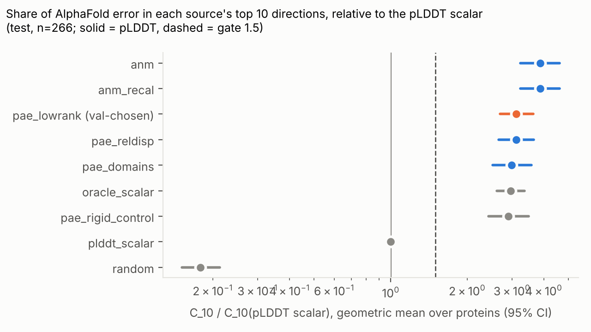
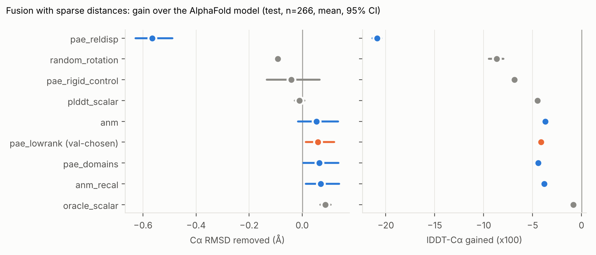

# Phase A4 results (generated by a4_alignment.py --summarize)

## val split (273 proteins)

Median AF Cα RMSD (core-superposed, all residues): 1.06 Å; median mean pLDDT 95.7.

### Capture ratio (geometric mean over proteins [95% CI])

| source | C_5 | C_10 | C_20 | C_10 / C_10(pLDDT scalar) | C_10, all-residue superposition | log-lik/dim |
|---|---|---|---|---|---|---|
| pae_reldisp | 18.3 [16.3, 20.5] | 16.0 [14.7, 17.5] | 11.4 [10.6, 12.2] | 2.50 [2.17, 2.89] | 16.0 | -4.848 |
| pae_domains | 13.8 [12.1, 15.7] | 16.2 [14.7, 18.0] | 12.4 [11.5, 13.5] | 2.53 [2.15, 2.98] | 16.2 | -1.824 |
| pae_lowrank (chosen) | 19.5 [17.4, 21.9] | 16.7 [15.3, 18.3] | 11.8 [11.0, 12.8] | 2.61 [2.30, 2.98] | 16.7 | -1.717 |
| anm | 24.5 [21.5, 27.9] | 18.7 [16.9, 20.7] | 13.1 [12.1, 14.2] | 2.93 [2.45, 3.48] | 18.8 | -1.901 |
| anm_recal | 24.5 [21.5, 27.9] | 18.7 [16.9, 20.7] | 13.1 [12.1, 14.2] | 2.93 [2.45, 3.48] | 18.8 | -1.908 |
| plddt_scalar | 6.2 [5.2, 7.3] | 6.4 [5.6, 7.4] | 5.7 [5.0, 6.4] | 1.00 [1.00, 1.00] | 6.4 | -2.016 |
| oracle_scalar | 20.1 [18.0, 22.3] | 16.7 [15.3, 18.4] | 12.6 [11.6, 13.6] | 2.61 [2.34, 2.91] | 16.7 | -0.354 |
| pae_rigid_control | 12.4 [10.8, 14.2] | 15.4 [13.9, 17.1] | 12.4 [11.5, 13.5] | 2.40 [2.02, 2.85] | 15.3 | -1.845 |
| random | 0.8 [0.8, 0.9] | 0.9 [0.9, 1.0] | 1.0 [0.9, 1.0] | 0.14 [0.12, 0.16] | 0.8 | — |

### Fusion: gain over the AlphaFold model (mean [95% CI])

Pairs 5–25 Å, 0.5/residue, noise 1.0 Å, 3 draws/protein. Positive = better.

| prior | ΔRMSD (Å) | ΔlDDT-Cα (x100) |
|---|---|---|
| pae_reldisp | -0.455 [-0.554, -0.330] | -20.91 [-21.32, -20.53] |
| pae_domains | +0.105 [+0.038, +0.194] | -4.50 [-4.78, -4.26] |
| pae_lowrank | +0.132 [+0.051, +0.241] | -4.13 [-4.49, -3.85] |
| anm | -0.082 [-0.229, +0.040] | -3.80 [-4.15, -3.51] |
| anm_recal | -0.008 [-0.127, +0.104] | -3.86 [-4.20, -3.61] |
| plddt_scalar | +0.038 [+0.002, +0.081] | -4.45 [-4.70, -4.27] |
| oracle_scalar | +0.136 [+0.098, +0.183] | -0.81 [-1.15, -0.53] |
| pae_rigid_control | +0.026 [-0.058, +0.132] | -6.81 [-7.31, -6.38] |
| random_rotation | -0.094 [-0.107, -0.081] | -9.30 [-10.31, -8.42] |

### Paired fusion differences vs controls (source − control; mean [95% CI], % proteins better)

| source | control | ΔΔRMSD (Å) | % better | ΔΔlDDT (x100) | % better |
|---|---|---|---|---|---|
| pae_lowrank | oracle_scalar | -0.004 [-0.062, +0.077] | 26% | -3.33 [-3.54, -3.13] | 4% |
| pae_lowrank | pae_rigid_control | +0.106 [+0.044, +0.165] | 82% | +2.68 [+2.38, +2.99] | 94% |
| pae_lowrank | pae_domains | +0.027 [-0.013, +0.068] | 69% | +0.36 [+0.18, +0.53] | 71% |
| pae_lowrank | plddt_scalar | +0.094 [+0.038, +0.176] | 68% | +0.32 [+0.16, +0.47] | 77% |
| pae_lowrank | random_rotation | +0.226 [+0.146, +0.336] | 93% | +5.16 [+4.49, +5.95] | 100% |
| anm | oracle_scalar | -0.218 [-0.385, -0.081] | 26% | -2.99 [-3.28, -2.73] | 5% |
| anm | pae_rigid_control | -0.108 [-0.261, +0.015] | 79% | +3.02 [+2.67, +3.37] | 95% |
| anm | pae_domains | -0.187 [-0.339, -0.063] | 67% | +0.70 [+0.48, +0.90] | 90% |
| anm | plddt_scalar | -0.120 [-0.282, +0.013] | 52% | +0.66 [+0.41, +0.87] | 92% |
| anm_recal | oracle_scalar | -0.143 [-0.285, -0.032] | 26% | -3.06 [-3.29, -2.82] | 6% |
| anm_recal | pae_rigid_control | -0.034 [-0.158, +0.061] | 79% | +2.95 [+2.62, +3.29] | 96% |
| anm_recal | pae_domains | -0.112 [-0.229, -0.025] | 71% | +0.63 [+0.44, +0.82] | 86% |
| anm_recal | plddt_scalar | -0.045 [-0.181, +0.063] | 65% | +0.59 [+0.40, +0.76] | 92% |
| pae_reldisp | oracle_scalar | -0.591 [-0.667, -0.494] | 7% | -20.11 [-20.45, -19.74] | 0% |
| pae_reldisp | pae_rigid_control | -0.482 [-0.544, -0.417] | 5% | -14.10 [-14.46, -13.73] | 0% |
| pae_reldisp | pae_domains | -0.560 [-0.612, -0.503] | 5% | -16.42 [-16.71, -16.12] | 0% |
| pae_reldisp | plddt_scalar | -0.493 [-0.567, -0.397] | 8% | -16.46 [-16.77, -16.15] | 0% |
| pae_domains | oracle_scalar | -0.031 [-0.081, +0.036] | 24% | -3.69 [-3.95, -3.42] | 6% |
| pae_domains | pae_rigid_control | +0.078 [+0.043, +0.111] | 86% | +2.31 [+2.08, +2.56] | 98% |
| pae_domains | plddt_scalar | +0.067 [+0.021, +0.131] | 39% | -0.04 [-0.23, +0.14] | 50% |

## test split (266 proteins)

Median AF Cα RMSD (core-superposed, all residues): 1.04 Å; median mean pLDDT 95.5.

### Capture ratio (geometric mean over proteins [95% CI])

| source | C_5 | C_10 | C_20 | C_10 / C_10(pLDDT scalar) | C_10, all-residue superposition | log-lik/dim |
|---|---|---|---|---|---|---|
| pae_reldisp | 18.4 [16.4, 20.6] | 15.9 [14.4, 17.6] | 11.5 [10.6, 12.5] | 3.11 [2.66, 3.66] | 15.9 | -4.808 |
| pae_domains | 13.6 [11.7, 15.8] | 15.3 [13.5, 17.3] | 11.5 [10.4, 12.7] | 2.99 [2.52, 3.58] | 15.3 | -1.580 |
| pae_lowrank (chosen) | 19.0 [16.8, 21.5] | 16.0 [14.4, 17.7] | 11.8 [10.8, 12.8] | 3.12 [2.70, 3.63] | 16.0 | -1.545 |
| anm | 26.9 [23.7, 30.6] | 19.8 [17.9, 22.0] | 13.4 [12.2, 14.6] | 3.87 [3.24, 4.62] | 19.9 | -1.787 |
| anm_recal | 26.9 [23.7, 30.6] | 19.8 [17.9, 22.0] | 13.4 [12.2, 14.6] | 3.87 [3.24, 4.62] | 19.9 | -1.795 |
| plddt_scalar | 4.7 [4.0, 5.7] | 5.1 [4.4, 6.0] | 5.2 [4.6, 6.0] | 1.00 [1.00, 1.00] | 5.1 | -1.812 |
| oracle_scalar | 17.4 [15.6, 19.5] | 15.2 [13.7, 16.7] | 11.8 [10.8, 12.9] | 2.96 [2.62, 3.36] | 15.2 | -0.377 |
| pae_rigid_control | 12.7 [10.9, 14.9] | 14.9 [13.1, 16.8] | 11.4 [10.3, 12.6] | 2.90 [2.43, 3.49] | 14.9 | -1.685 |
| random | 0.8 [0.8, 0.9] | 0.9 [0.9, 1.0] | 0.9 [0.9, 1.0] | 0.18 [0.15, 0.21] | 0.9 | — |

### Fusion: gain over the AlphaFold model (mean [95% CI])

Pairs 5–25 Å, 0.5/residue, noise 1.0 Å, 3 draws/protein. Positive = better.

| prior | ΔRMSD (Å) | ΔlDDT-Cα (x100) |
|---|---|---|
| pae_reldisp | -0.566 [-0.628, -0.489] | -20.90 [-21.35, -20.45] |
| pae_domains | +0.064 [+0.004, +0.137] | -4.44 [-4.63, -4.25] |
| pae_lowrank | +0.059 [+0.013, +0.121] | -4.15 [-4.48, -3.85] |
| anm | +0.054 [-0.016, +0.135] | -3.71 [-4.00, -3.47] |
| anm_recal | +0.070 [+0.014, +0.139] | -3.80 [-4.05, -3.59] |
| plddt_scalar | -0.010 [-0.027, +0.009] | -4.49 [-4.70, -4.30] |
| oracle_scalar | +0.087 [+0.069, +0.107] | -0.85 [-1.21, -0.53] |
| pae_rigid_control | -0.042 [-0.133, +0.066] | -6.84 [-7.19, -6.51] |
| random_rotation | -0.092 [-0.103, -0.080] | -8.68 [-9.45, -7.99] |

### Paired fusion differences vs controls (source − control; mean [95% CI], % proteins better)

| source | control | ΔΔRMSD (Å) | % better | ΔΔlDDT (x100) | % better |
|---|---|---|---|---|---|
| pae_lowrank | oracle_scalar | -0.027 [-0.060, +0.020] | 21% | -3.30 [-3.49, -3.10] | 5% |
| pae_lowrank | pae_rigid_control | +0.101 [+0.021, +0.171] | 83% | +2.69 [+2.40, +2.98] | 94% |
| pae_lowrank | pae_domains | -0.005 [-0.047, +0.030] | 70% | +0.29 [+0.03, +0.52] | 73% |
| pae_lowrank | plddt_scalar | +0.069 [+0.036, +0.118] | 67% | +0.34 [+0.18, +0.48] | 81% |
| pae_lowrank | random_rotation | +0.151 [+0.110, +0.211] | 95% | +4.53 [+4.06, +5.05] | 100% |
| anm | oracle_scalar | -0.033 [-0.096, +0.038] | 26% | -2.87 [-3.08, -2.65] | 7% |
| anm | pae_rigid_control | +0.095 [+0.023, +0.163] | 82% | +3.12 [+2.81, +3.43] | 96% |
| anm | pae_domains | -0.010 [-0.055, +0.031] | 69% | +0.72 [+0.47, +0.94] | 88% |
| anm | plddt_scalar | +0.064 [+0.001, +0.136] | 56% | +0.77 [+0.61, +0.91] | 93% |
| anm_recal | oracle_scalar | -0.017 [-0.063, +0.043] | 23% | -2.95 [-3.17, -2.73] | 8% |
| anm_recal | pae_rigid_control | +0.111 [+0.039, +0.176] | 84% | +3.04 [+2.73, +3.33] | 96% |
| anm_recal | pae_domains | +0.006 [-0.030, +0.038] | 73% | +0.63 [+0.41, +0.83] | 88% |
| anm_recal | plddt_scalar | +0.080 [+0.033, +0.140] | 70% | +0.68 [+0.55, +0.80] | 96% |
| pae_reldisp | oracle_scalar | -0.652 [-0.707, -0.588] | 5% | -20.05 [-20.41, -19.66] | 0% |
| pae_reldisp | pae_rigid_control | -0.524 [-0.593, -0.464] | 6% | -14.06 [-14.46, -13.64] | 1% |
| pae_reldisp | pae_domains | -0.630 [-0.668, -0.591] | 4% | -16.46 [-16.85, -16.08] | 0% |
| pae_reldisp | plddt_scalar | -0.555 [-0.608, -0.491] | 5% | -16.41 [-16.75, -16.08] | 0% |
| pae_domains | oracle_scalar | -0.023 [-0.077, +0.039] | 21% | -3.59 [-3.89, -3.26] | 8% |
| pae_domains | pae_rigid_control | +0.106 [+0.059, +0.149] | 87% | +2.40 [+2.18, +2.63] | 99% |
| pae_domains | plddt_scalar | +0.074 [+0.021, +0.136] | 35% | +0.05 [-0.11, +0.22] | 54% |

## Gate (A5), test split, pre-registered criteria

- pae_lowrank vs oracle_scalar: RMSD -0.027 [-0.060, +0.020] Å (21% better), lDDT -3.30 [-3.49, -3.10] (5% better) -> fail
- pae_lowrank vs pae_rigid_control: RMSD +0.101 [+0.021, +0.171] Å (83% better), lDDT +2.69 [+2.40, +2.98] (94% better) -> pass
- pae_lowrank: (i) ratio 3.12 [2.70, 3.63] -> pass; (ii) -> fail
- (stricter, not in the gate) pae_lowrank vs fitted pae_domains: RMSD -0.005 [-0.047, +0.030] Å (70%), lDDT +0.29 [+0.03, +0.52] (73%) -> fail
- anm vs oracle_scalar: RMSD -0.033 [-0.096, +0.038] Å (26% better), lDDT -2.87 [-3.08, -2.65] (7% better) -> fail
- anm vs pae_rigid_control: RMSD +0.095 [+0.023, +0.163] Å (82% better), lDDT +3.12 [+2.81, +3.43] (96% better) -> pass
- anm: (i) ratio 3.87 [3.24, 4.62] -> pass; (ii) -> fail
- (stricter, not in the gate) anm vs fitted pae_domains: RMSD -0.010 [-0.055, +0.031] Å (69%), lDDT +0.72 [+0.47, +0.94] (88%) -> fail

**Primary-set verdict: NO-GO on the primary set** (PARTIAL requires the ATLAS/MD secondary set, reported separately).

